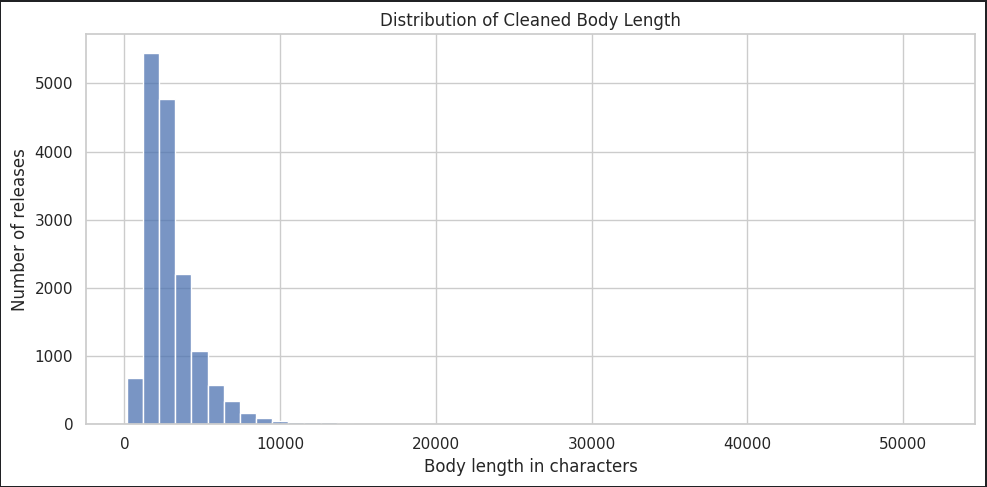
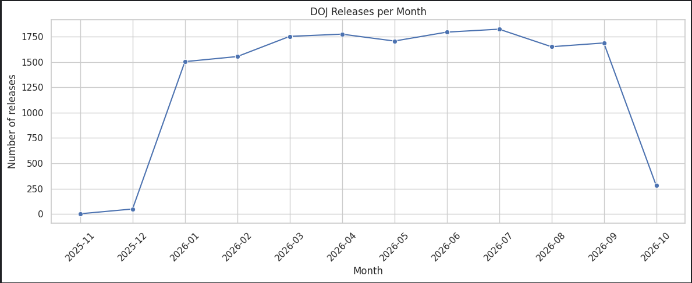
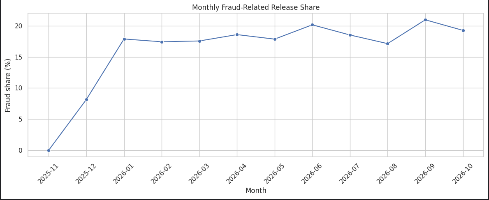
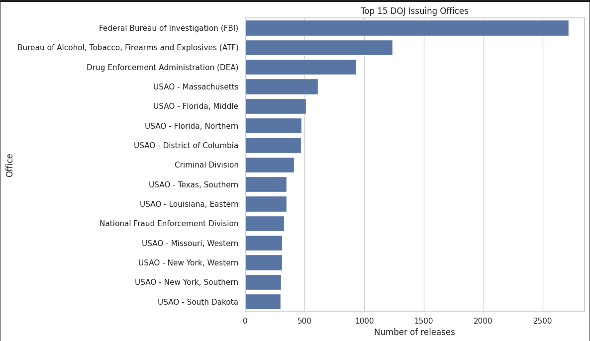
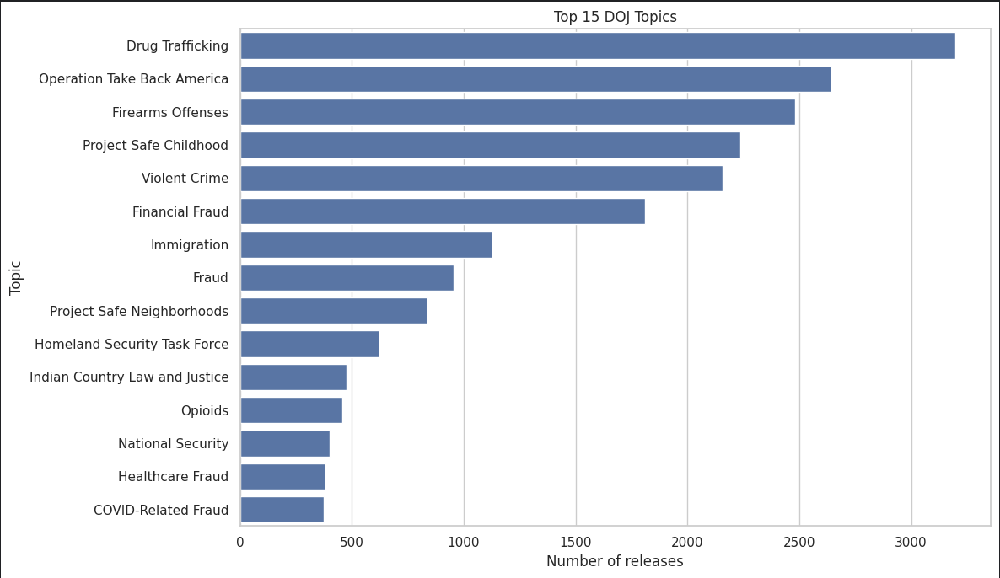

# Faithful Report Generation with Large Language Models

**Master's Project | Data Science and Artificial Intelligence (SDIA)**  
Faculty of New Information and Communication Technologies (NTIC)  
Abdelhamid Mehri – Constantine 2 University

> **Status: Part 1 Completed — Dataset Preparation, Cleaning and EDA**

---

## Overview

Large Language Models (LLMs) can generate fluent reports from documents, but fluency does not guarantee factual accuracy. In sensitive domains such as fraud investigation, incorrect names, financial amounts, or legal statuses can lead to misleading reports.

This project explores **faithful report generation using Large Language Models (LLMs)** on real fraud-related press releases published by the U.S. Department of Justice (DOJ).

The objective is to generate structured reports based on source documents and automatically evaluate whether the generated information is supported by the original text.

The project is developed as part of the *Intelligent Techniques for Fighting Fraud and Corruption (ITFFC)* course workshop.

## Project Objectives

- Prepare and document a dataset of fraud-related DOJ press releases.
- Explore and analyze the dataset.
- Prepare structured factsheets for selected fraud cases.
- Build a blind report-generation baseline.
- Develop a grounded report generator using source documents.
- Implement an automatic claim verification system.
- Evaluate report faithfulness using quantitative metrics.
- Analyze the limitations of automatic evaluation.

## Project Workflow

| Part | Description | Status |
|---|---|---|
| Part 1 | Dataset preparation, cleaning, fraud-related selection, EDA and factsheet preparation | Completed |
| Part 2 | Blind baseline and grounded report generation | Planned |
| Part 3 | Automatic claim checker and error-injection validation | Planned |
| Part 4 | Evaluation, comparison and error analysis | Planned |
| Part 5 | Final analysis, report and presentation | Planned |

---

## Part 1 — Dataset Preparation and EDA

### Dataset Source

The dataset consists of public press releases published by the U.S. Department of Justice (DOJ).

The workshop uses a frozen dataset snapshot, `releases_merged.json`, provided by the instructor to ensure that all students work on the same data.

The dataset contains information including:

- UUID
- Title
- Publication date
- Body text
- Topics
- Issuing component
- URL

### Data Preparation

The preprocessing workflow includes:

- Loading and inspecting the JSON dataset.
- Removing duplicate records.
- Selecting relevant columns.
- Cleaning HTML content from the press release body.
- Converting publication dates.
- Preparing text fields for analysis.
- Identifying missing values.
- Selecting fraud-related press releases.
- Preparing the processed dataset for subsequent project stages.

### Fraud-Related Document Selection

Fraud-related press releases were selected using the available topic information and relevant textual information.

The selected documents form the basis for the subsequent report-generation and faithfulness evaluation stages.

### Exploratory Data Analysis

The EDA was conducted to understand the dataset's structure, temporal distribution, text characteristics and metadata.

The analysis includes:

- Distribution of cleaned press release body lengths.
- DOJ press releases per month.
- Monthly distribution of fraud-related press releases.
- Top 15 DOJ issuing offices.
- Top 15 DOJ topics.

### Missing Topic Prediction

Missing topic values were addressed using a text-based machine learning approach.

The press release body text was used as input to predict missing topic labels.

The workflow includes:

1. Identifying documents with missing topic labels.
2. Preparing the available body text.
3. Text representation using TF-IDF.
4. Training a Logistic Regression classifier using documents with available topic labels.
5. Predicting missing topic labels.
6. Reviewing prediction confidence and identifying uncertain predictions.

The predicted topics are treated as machine-generated predictions and are distinguished from the original DOJ metadata.

### Factsheet Preparation

Factsheets were prepared for selected fraud-related cases to organize relevant information from the original press releases.

These factsheets are intended to support the future report-generation and automatic verification stages.

Information is based on the source documents, without adding unsupported facts.

---

## Part 1 Results

### Exploratory Data Analysis

#### Distribution of Cleaned Body Length



#### DOJ Press Releases Per Month



#### Monthly Fraud-Related Press Releases



#### Top 15 DOJ Issuing Offices



#### Top 15 DOJ Topics



---

## Repository Structure

```text
faithful-report-generation-llms/
│
├── docs/
│   └── data_card.md
│
├── figures/
│   ├── Distribution_of_Cleaned_Body_Length.png
│   ├── DOJ_Per_Month.png
│   ├── Monthly_Fraud_Related.png
│   ├── Top_15_DOJ_Issuing_Offices.png
│   └── Top_15_DOJ_Topic.png
│
├── notebooks/
│   └── dataset_preparation_and_eda.ipynb
│
├── results/
│   ├── facts_sheet_final.csv
│   ├── fraud_selected_final.csv
│   └── releases_final.csv
│
└── README.md
```

## Repository Contents

| Folder/File | Description |
|---|---|
| `docs/data_card.md` | Dataset documentation, provenance, characteristics and preparation details |
| `figures/` | Visualizations generated during exploratory data analysis |
| `notebooks/dataset_preparation_and_eda.ipynb` | Notebook containing dataset preparation, cleaning, selection, EDA and related analysis |
| `results/facts_sheet_final.csv` | Factsheets for selected fraud-related cases |
| `results/fraud_selected_final.csv` | Selected fraud-related press releases |
| `results/releases_final.csv` | Prepared dataset of press releases |

## Technologies Used

- Python
- Jupyter Notebook
- Pandas
- NumPy
- Matplotlib
- Seaborn
- BeautifulSoup
- Regular Expressions
- Scikit-learn
- TF-IDF
- Logistic Regression

## Data Source

**U.S. Department of Justice (DOJ)** — Public Press Releases

The dataset is based on the DOJ News API and the frozen dataset snapshot provided for the workshop.

The original data source is acknowledged as part of the project documentation.

## Responsible Use

This project involves public documents describing real people and legal proceedings.

The following principles are considered:

- Use source documents as the basis for factual information.
- Avoid introducing unsupported information.
- Distinguish allegations, charges, guilty pleas, convictions and sentences.
- Treat predicted topic labels as predictions rather than original metadata.
- Do not infer missing facts.
- Recognize the limitations of automatic factual verification.

## Future Work

- **Part 2:** Implement blind baseline and grounded report generators.
- **Part 3:** Develop and validate an automatic claim checker using injected errors.
- **Part 4:** Evaluate faithfulness, compare the generators and analyze errors.
- **Part 5:** Final analysis, limitations, report and presentation.

## Academic Context

This project is part of the workshop **Faithful Report Generation with Large Language Models**, conducted within the Master's Program in Data Science and Artificial Intelligence (SDIA) at Abdelhamid Mehri – Constantine 2 University.

**Instructor:** Dr. Guelib Bouchra  
**Workshop duration:** 12 October – 30 November 2026  
**Academic year:** 2026

